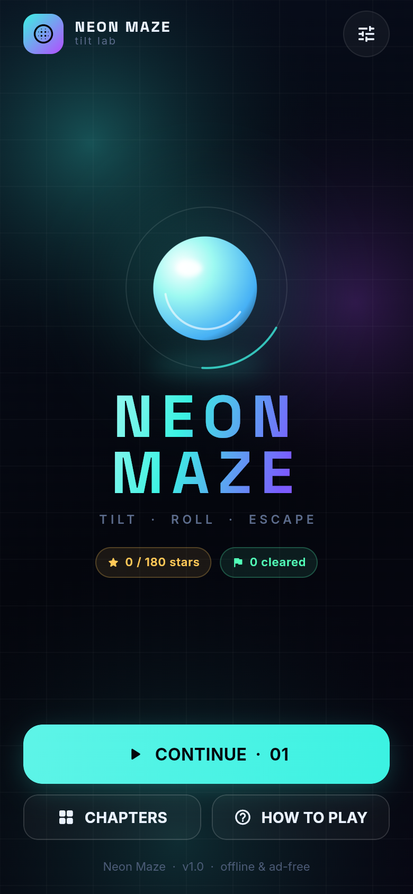
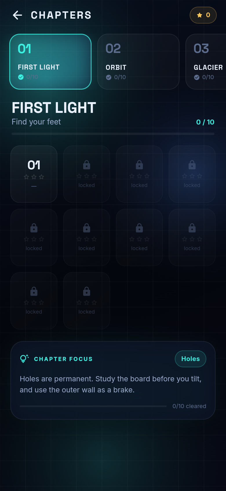
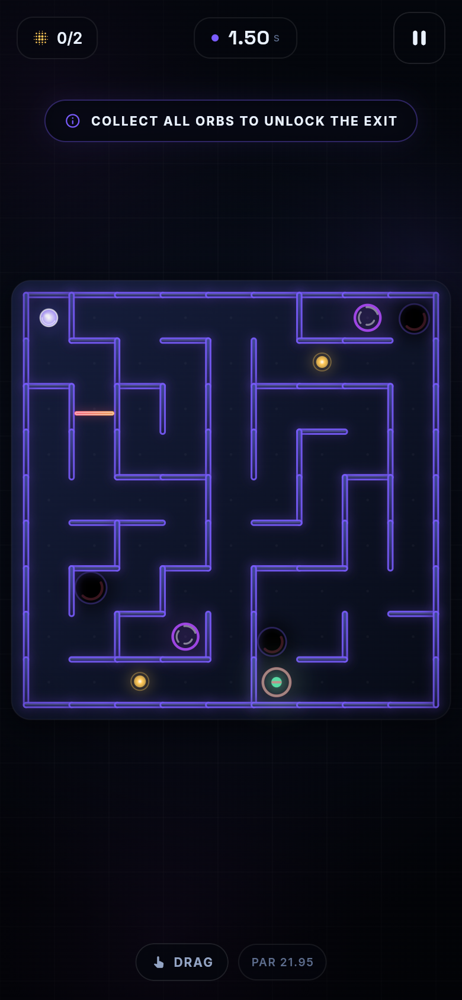
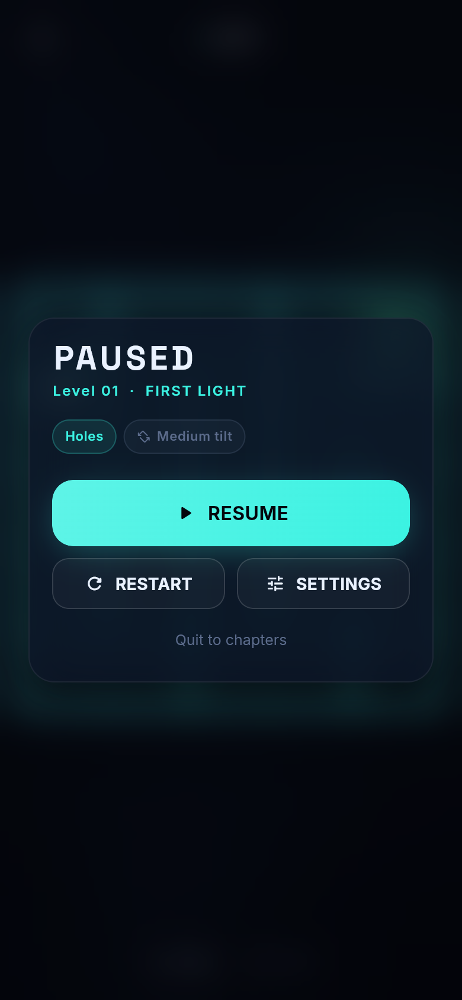
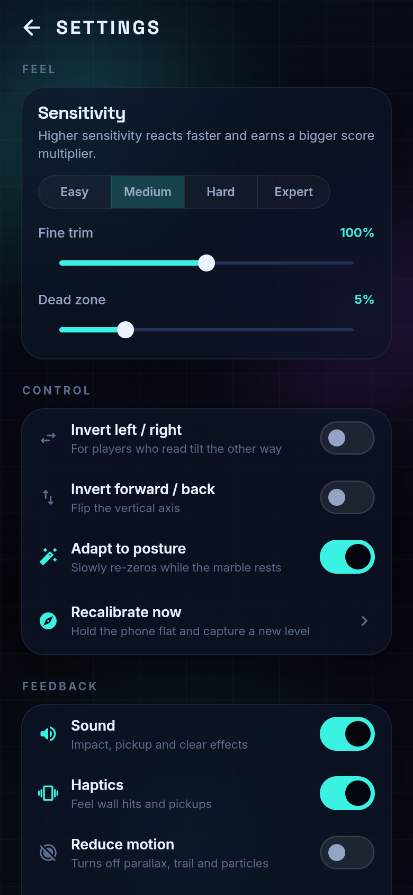

# Neon Maze

A tilt-controlled marble maze for Android, built in Flutter. Tilt your phone, roll a
glass marble through neon mazes, collect energy orbs and escape before par time.

Inspired by the *ball-in-a-maze* genre (the original reference was PineSoft's `Gyro Maze`),
but with an original identity, levels, mechanics, art and audio. No ads, no IAP, no network.

## Play it

- **Browser demo:** <https://giridhar0025.github.io/neon-maze/>
- **Android QA build:** <https://github.com/giridhar0025/neon-maze/releases/tag/v1.5.0>

The Android APK is a debug-signed QA build with all levels unlocked for testing, not a
Play Store release.

| Home | Chapters | Gameplay | Pause | Settings |
|---|---|---|---|---|
|  |  |  |  |  |

## What it does

- **Real tilt control** via the accelerometer, with calibration, dead zone, sensitivity
  presets, fine trim, axis inversion and slow posture adaptation.
- **Touch and keyboard fallback** — drag anywhere or use WASD/arrows on desktop, so the
  game is playable in a browser, on a tablet without a gyro, or in an emulator.
- **800 generated levels** — eight chapters of one hundred, each split into five
  20-level acts. Chapters introduce holes, energy orbs, pulse gates, portals,
  one-way flow panels, conveyor belts, breakable walls, sliding walls, magnets,
  bumpers, tar detours and blackout.
- **Readable late-game boards** — grid size is deliberately capped at 14×18, so
  a phone still draws a ~26 px cell. Difficulty comes from longer routes, tighter
  par times, act structure and hazard placement, not from shrinking the maze.
- **Strict critical-path hazards** — junctions, turns, side-branch entrances and
  the exit approach score highest, so gates, sliders, bumpers, magnets and holes
  land where the player is actually making a decision. Gates and sliders need a
  real straight run; belts need a long run with room on both sides; breakables
  need a large route shortcut; holes keep a clear cell between each other. A
  route-length hazard budget prevents late boards becoming cluttered.
- **Testing build opens the catalog** — all 800 levels are unlocked by default
  while QA is in progress. Ship a locked build with
  `--dart-define=NM_UNLOCK_ALL=false`.
- **Five in-maze superpowers** — Shield, Magnet, Phase, Slow Field and Reveal.
  They sit on optional detours, fill a three-slot belt and are tapped when needed.
- **Looping music and a daily loop** — synthesized menu/game/blackout tracks,
  a date-seeded daily challenge with streaks, three daily missions, sparks and
  cosmetic marble finishes to unlock.
- **Natural-weight marble physics** — moderate gravity, real rolling resistance and a
  lower speed cap; the marble responds immediately but settles like an object.
- **Three-star par times**, persistent best times, score multipliers and level unlocking.
- **Neon-glass renderer**: cached board art, joined neon wall networks with corner
  collars and bolts, a speed-reactive glass marble, tapered trail, layered drop holes,
  orb bursts and a blackout light mask.
- **Physical feedback**: synthesized SFX (generated locally, no samples) and throttled haptics.
- **Accessibility**: reduce-motion mode, colourblind accents, left-handed HUD, adjustable
  dead zone, and no colour-only state (locked exits show a crossbar, open exits show chevrons).
- **Offline-first**: progress and settings live in `SharedPreferences`; there is no network
  permission in the Android manifest.

## Run it

```bash
# Flutter 3.47.7 / Dart 3.13.5
export PATH="$HOME/development/flutter/bin:$PATH"

flutter pub get
flutter run -d chrome          # fastest preview (drag or arrow keys)
flutter run -d macos           # desktop preview
flutter run -d <android-device> # real tilt on a phone

# Builds
flutter build apk --release
flutter build appbundle --release
flutter build web --release
```

The Android package id is `dev.pulichara.neon_maze`; change it in
`android/app/build.gradle.kts` before publishing.

### Dev deep links

The app accepts `--dart-define` entry points for layout/QA work:

```bash
flutter run -d chrome --dart-define=NM_START=game:12 --dart-define=NM_SKIP_ONBOARDING=true
# NM_START: home | levels | settings | howto | game:<0-based id>
# Locked store build (progression enforced): --dart-define=NM_UNLOCK_ALL=false
```

## Tests

```bash
flutter analyze
flutter test
```

Coverage is focused on the parts that are easy to break silently:

- maze connectivity, wall symmetry, solution validity, farthest-cell goal;
- every one of the 800 levels builds, orbs/holes/power-ups stay reachable, all placed mechanics appear,
  and hazards only land on the critical route with legal spacing;
- route targets and hazard budgets ramp through the acts, tar never sits on the main route;
- the testing build opens all 800 levels;
- daily challenge determinism and the daily mission/streak/skin economy;
- marble physics: acceleration, no wall tunnelling, orb/exit rules, fall events, reset,
  score ordering, and 20 seconds of randomised input without NaN or escape;
- unlock/progression/persistence and star/best-time rules;
- sensor axis mapping (the bug class that makes tilt feel inverted).

## Architecture

```
lib/
  main.dart / app.dart       bootstrap, portrait lock, dev deep links
  data/store.dart            settings, records, daily missions, sparks, skins
  game/
    maze.dart                seeded DFS maze, braiding, BFS distances, wall boxes
    levels.dart              800-level catalog, critical-path hazard placement, par times
    powerups.dart            superpower definitions and pickup model
    daily.dart               date-seeded daily challenge remix
    simulation.dart          engine-free circle/AABB physics, power-up effects
    tilt.dart                accelerometer -> calibrated, filtered, scaled tilt
    particles.dart           pooled sparks/bursts
  render/scene_painter.dart  cached static board + live scene + spirit level
  ui/                        home, chapters, game, settings, how-to, shared widgets
  theme/                     palette, chapter identities, type ramp, marble skins
tool/                        generator scripts for audio and app icons
```

**Why no physics package?** A marble versus static boxes is a small, well-understood
problem. Doing it directly gives deterministic tests, zero native dependencies, and full
control over feel.

The simulation runs at a **fixed 240 Hz** with an accumulator, so 60/90/120 Hz displays
produce the same trajectory and a dropped frame cannot tunnel through a wall. Gravity is
projected from the tilt vector; rolling resistance is linear plus a small quadratic drag.
Wall contact keeps a light bounce, applies tangential friction **only on a real impact**,
and fires **no** sparks, haptics or SFX — grazing a wall is silent and the marble slides
instead of sticking. `rollAngle`/`rollDirection` drive visible surface flecks on the
marble, which is what makes it read as a rolling ball rather than a sliding dot.
Conveyors add a directional force, magnets add a radial force with falloff, and sliding
walls are resolved as moving AABBs.

**Rendering cost.** The board (background, walls, holes, exit base) is rendered
once per level/size into a `ui.Image` via `Picture.toImageSync`, then blitted each frame.
Only gates, belts, sliders, magnets, orbs, portals, flow panels, breakables, live hole
rims, trail, marble, particles and the blackout mask are live.

## REA analysis

`morluto/rea` is a reverse-engineering MCP/CLI, not a game library. It was used to inspect
the reference APK (`GyroMaze_1.0.4_APKPure.xapk`): Flutter build identification, Dart AOT
snapshot/string-pool inspection and dependency/class recovery. Findings and the resulting
feature decisions are in [`docs/FEATURE-GAP.md`](docs/FEATURE-GAP.md).

No strings, assets, audio, level seeds or code from the original are reused.

## Roadmap to a store launch

Shipped in 1.4.0: 800 levels, critical-path hazard placement, five superpowers,
looping music, daily challenge + streak, daily missions, sparks, cosmetic marble
skins, and a readability pass on late boards.

Shipped in 1.5.0 (QA build): stricter obstacle placement and timing, longer routes
with deeper orb detours, late-game tar detours, a new N-monogram logo built from
maze walls, adaptive Android icons and a 32 px favicon, and all levels unlocked for testing.

Still recommended before/at launch:

- Play Games Services / Game Center leaderboards and a handful of achievements.
- iCloud/Google Play cloud save, so a reinstall does not lose 800 levels of progress.
- Localisation pass (the genre audience is global; strings are currently English).
- Share card for daily results and chapter milestones.
- More long-tail events: weekly gauntlet, limited-time marble finishes, chapter chests.
- Store assets: feature graphic, six screenshots per platform, preview video, privacy
  policy URL and the App Store/Play data-safety forms.

Publishing steps, store copy and the real-device QA list are in [`docs/RELEASE.md`](docs/RELEASE.md).

## Credits

- **Space Grotesk** and **Inter** typefaces: SIL Open Font License 1.1
  (see `assets/fonts/OFL.txt`).
- **SFX**: synthesized from scratch by `tool/gen_audio.py`; no third-party samples.
- **App icon and screenshots**: generated locally by `tool/gen_icon.py` and the running app.
